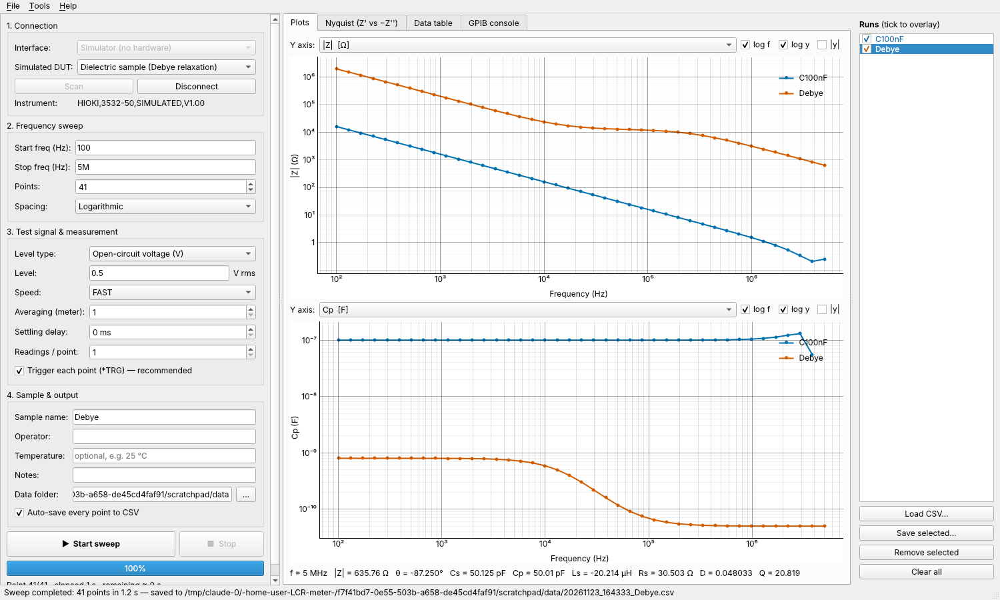
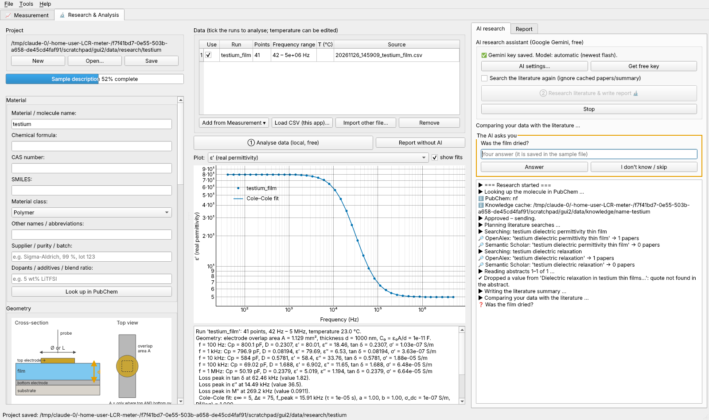

# LCR Sweep: frequency-dependent measurements with the Hioki 3532-50

A desktop application for Windows that controls a **Hioki 3532-50 LCR HiTESTER** over **GPIB**
(Keithley **KUSB-488A** USB-GPIB adapter). It sweeps the test frequency (42 Hz to 5 MHz) and records the
impedance at every point. It plots the results live and saves them as CSV or Excel.



## What it measures

At every frequency the meter returns **|Z|** and **θ**. The program calculates all other parameters from
these two values, with the same formulas the meter uses internally:

| Series circuit | Parallel circuit | Other |
|---|---|---|
| Rs, X, Ls, Cs | Rp, Lp, Cp, G, B | \|Y\|, D (tan δ), Q |

The app also has:

* Log, linear or custom frequency lists, with SI input (`100`, `1k`, `2.5M`).
* Level type V, CV or CC; speed FAST, NORMAL, SLOW or SLOW2; meter averaging; and a settling delay after each frequency change.
* An option to take several readings per point, which saves the mean and standard deviation of |Z| and θ.
* Live plots: any two parameters against frequency, each with its own log scale, plus a **Nyquist plot** (Z′ vs −Z″) and a data table.
* **Crash-safe autosave**: each point is written to the CSV as soon as it is measured.
* Overlays of several runs or old CSV files for comparing samples.
* Export of all runs to Excel, and of the plots as PNG.
* Sample metadata (name, operator, temperature, notes) and all instrument settings, stored in the CSV header.
* A **GPIB console** for typing any command by hand.
* A **simulator** for trying the app without the meter.
* A **Research & Analysis tab** that computes permittivity, fits the data, compares it with the literature using a free AI model, and writes a scientific report. See [section 8](#8-research--analysis-tab).

## 1. Hardware setup

1. The 3532-50 needs the **9518-01 GP-IB interface board** fitted in the rear option slot.
2. On the meter, open the interface settings screen and set a **GPIB address**, for example `1`.
3. Connect the GPIB cable to the KUSB-488A and plug the adapter into a USB port on the laptop.

## 2. Driver for the Keithley KUSB-488A (Windows 10/11)

Install the **KUSB-488A driver** from Tektronix/Keithley (tek.com → Support → Software → search "KUSB-488A").
It installs an NI-488.2 compatible `gpib-32.dll`. Then run the **KUSB-488 Configuration utility** and check
that the adapter shows up as **board 0** (GPIB0).

The app can talk to the meter in two ways:

| Interface in the app | Requirements |
|---|---|
| **GPIB-32 DLL (KUSB-488A driver)** (recommended) | Only the KUSB-488A driver. The app calls `gpib-32.dll` directly. |
| **VISA** | A VISA library as well: Keithley I/O Layer (KI-VISA), or NI-VISA with third-party GPIB ("passport") support. Resource name `GPIB0::1::INSTR`. |

## 3. Install and run the software

1. Install **Python 3.10 or newer** from python.org and tick "Add Python to PATH".
2. Double-click **`setup_windows.bat`** once. It installs the libraries.
3. Double-click **`run_lcr.bat`** to start the program.

Optional: **`build_exe.bat`** builds a stand-alone `dist\LCRSweep\LCRSweep.exe` that runs on lab PCs without Python.

## 4. First measurement

1. **Connection**: choose *GPIB-32 DLL* and click **Scan**. The app finds the meter's address. Then click **Connect**, and the Instrument field should show `HIOKI,3532-50,…`.
2. **Tools → Verify command profile on meter**: sends every command once and reads the meter's error register. Do this once with a new meter (see section 6).
3. Run the open and short compensation **on the meter's front panel** for your fixture. The compensation stays stored in the meter.
4. Set the start and stop frequency, number of points, level and speed. Enter the sample name and click **Start sweep**.
5. The data is saved automatically to `C:\Users\<you>\LCR_data\YYYYMMDD_HHMMSS_<sample>.csv`. You can change the folder.

## 5. How fast is it?

PyQt is not the limiting factor. The time per point is set by the meter:

| Speed | Measuring time per reading (datasheet) |
|---|---|
| FAST | 5 ms |
| NORMAL | 21 ms |
| SLOW / SLOW2 | 72 ms / 140 ms |

A GPIB command and response take about 1–2 ms. The real cost is the **settling delay** after each frequency
change and the meter's **auto-ranging**. A 51-point sweep in NORMAL mode takes about 3–5 s.

The measurement runs in a background thread, so the window stays responsive. The 3532-50 has no internal
memory for storing a frequency sweep: its panel memory saves settings only. Measuring live from the PC is
therefore both the fastest and the only option, and every point reaches the disk at once.

For precise results (dielectrics, low D values), use **SLOW2**, averaging 4–16, and a settling delay of 100–200 ms.

## 6. GPIB commands (command profile)

All commands sent to the meter are in
[`lcr_app/instrument/commands_3532_50.json`](lcr_app/instrument/commands_3532_50.json).

| Purpose | Command |
|---|---|
| Identify | `*IDN?` |
| Frequency | `:FREQuency 1.00000E+03` |
| Level type / value | `:LEVel V` + `:LEVel:VOLTage 1` (also `CV`/`:LEVel:CVOLTage`, `CC`/`:LEVel:CCURrent`) |
| Speed, averaging, range | `:SPEEd NORMal`, `:AVERaging 4`, `:RANGe:AUTO ON` |
| Response = \|Z\|, θ | `:HEADer OFF`, `:MEASure:ITEM 5,0` |
| Trigger one reading | `:TRIGger EXTernal`, `*TRG`, `:MEASure?` |

The full command reference for the 3532-50 is in the separate **9518-01 GP-IB Interface** manual, and these
command strings have not yet been checked against it. If **Tools → Verify command profile** reports a
`FAIL`, correct that line in the JSON file (**Tools → Open command profile**), then click
**Tools → Reload command profile**. You don't need to change any code.

## 7. File format

```
# sample: C100nF
# level_mode: V
# speed: NORMal
...
index,freq_set_Hz,freq_Hz,Z_ohm,theta_deg,Rs_ohm,X_ohm,Ls_H,Cs_F,Rp_ohm,Lp_H,Cp_F,Y_S,G_S,B_S,D,Q,Z_std,theta_std,timestamp
0,100,100,15920.2,-89.98,5.56,-15920.2,...
```

Lines starting with `#` hold metadata. Excel, Origin, MATLAB and Python all read the file directly, for example:

```python
import pandas as pd
df = pd.read_csv("20261123_164308_C100nF.csv", comment="#")
```

## 8. Research & Analysis tab



This tab turns a measurement into a short scientific report. It also works without the meter: you can
load CSV files from this app, or **import files from any instrument or software** by mapping their
columns (Cp & D, Cs & D, Cp & Rp, |Z| & θ, Z′ & Z″, or ε′ & ε″).

**Step 1: describe the sample.** The form is organised in sections: material, geometry, film preparation,
measurement conditions and aim. The **sample type** (thin-film sandwich, pellet, IDE, liquid cell or
unknown) changes both the fields and the **diagram**. The diagram highlights in orange the dimension you
are typing, for example the thickness *d* or the electrode overlap area. **Look up in PubChem** fills in
the formula, CAS number, SMILES and synonyms. The description is saved as `sample_info.json` in the
project folder `<data folder>/research/<material>/`.

**Step 2: ① Analyse data (local, free, no AI).**
- Permittivity and related quantities: ε′, ε″, tan δ, σ′ and M″, calculated from Cp, G and C₀ = ε₀A/d.
- **Havriliak–Negami / Cole–Cole** relaxation fit with a dc-conductivity term, and a **Jonscher** power-law fit.
- Loss-peak detection, and an Arrhenius activation energy if the runs have three or more temperatures.
- **Thin-film data-quality checks:** electrode polarisation, electrode series resistance (e.g. ITO) with its
  RC corner frequency, stray capacitance compared with the sample capacitance, leakage, short circuits,
  inductive artefacts, ε′ < 1, and the instrument's impedance range.

**Step 3: ② Research literature & write report (Google Gemini, free key).**
1. Before anything is sent, a window shows **exactly** what will go to Google: the sample description
   and the numeric summary, never the raw files. Nothing is sent unless you approve. In *AI settings*
   you can also choose to approve every single request.
2. Gemini plans the search queries. Free databases then search for papers: **OpenAlex** and
   **Semantic Scholar**.
3. Gemini reads the abstracts and extracts reported values (ε′, tan δ, σ, relaxation frequency, Eₐ …)
   with their conditions. **A value is kept only if Gemini quotes the sentence it came from, and the code
   finds that sentence in the abstract.**
4. Gemini writes a literature summary, then compares it with your data. It can search again, look up a
   measured value at a given frequency, or **ask you a question** (for example "Was the film dried?").
   Your answer is saved in the sample file.
5. **Every cited DOI is checked with Crossref.** Unknown or invented citations are removed automatically.

**The report** contains:
- Summary and sample/methods.
- Results tables and fits, with 5 figures that include literature values as markers.
- Data-quality section and literature context.
- Comparison with the literature: a numeric table made by code, plus the AI's assessment.
- Discussion, conclusions and next measurements.
- Verified references, and a transparency appendix that shows what was sent to the AI.

It is saved as `report.md`, `report.html`, `report_standalone.html` (one file with the images inside),
**`report.docx`** and `references.bib`. **Report without AI** produces the same report with only the
local analysis.

**Caching, so work is never repeated:**

| What | Where | Reused |
|---|---|---|
| Molecule (PubChem) | `knowledge/<InChIKey>/molecule.json` | always |
| Searches, papers, extracted values | `knowledge/<material>/` | always (searches for 180 days) |
| Literature summary | `knowledge/<material>/literature_summary.md` | until older than 180 days, or you tick "Search the literature again" |
| DOI checks | `knowledge/_crossref.json` | always |
| Analysis of a data file | `research/<material>/.cache/` | until the data or the geometry changes |

The second report on the same material therefore only runs the comparison and the writing step.

**Gemini key (free):** in **AI settings**, click **Get free key**. This opens
[aistudio.google.com/apikey](https://aistudio.google.com/apikey). Sign in, click *Create API key*, paste
the key, then click **Test & load models**. The key is stored in the **Windows Credential Manager**,
never in a file. The model is chosen automatically (the newest "flash" model), or you can pick one
yourself. On the free tier, Google may use the requests to improve its products. That is why every
send needs your approval.

## Project layout

```
lcr_app/
  instrument/  transport.py (VISA + gpib-32.dll), hioki3532.py (driver), simulator.py, commands_3532_50.json
  core/        params.py (Z, θ → all parameters), sweep.py (sweep engine), storage.py (CSV/Excel)
  research/    sample.py (sample form schema), dielectric.py (ε, fits, checks), importer.py (any CSV),
               sources.py (PubChem/OpenAlex/Semantic Scholar/Crossref), knowledge.py (cache),
               llm.py (Gemini), agent.py (research agent), report.py (MD/HTML/Word), figures.py
  gui/         main_window.py, worker.py, research_tab.py, research_dialogs.py, diagrams.py (SVG)
tests/         pytest tests (run: python -m pytest tests) – AI and web services are mocked
```

To develop or run from source on any OS: `pip install -r requirements.txt` then `python -m lcr_app`.
